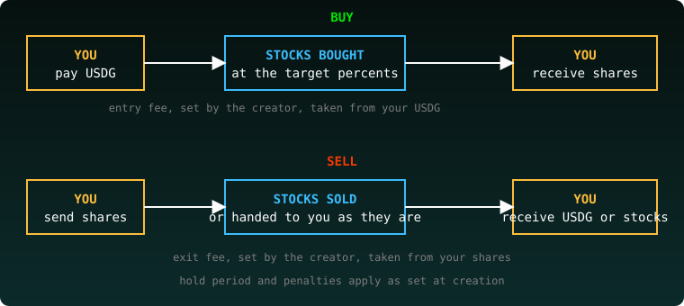
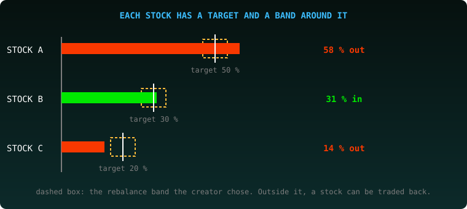
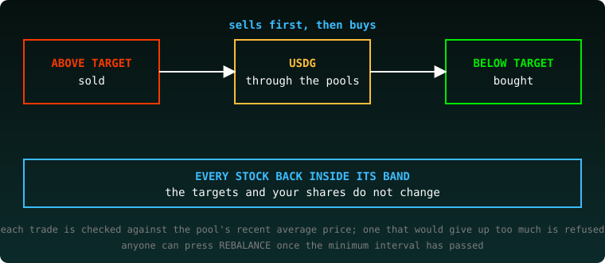
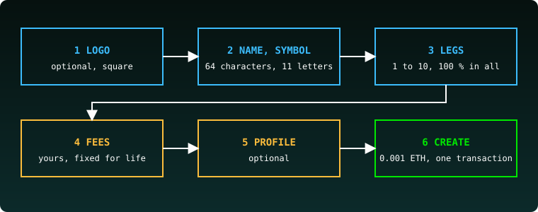

# ETFs

Baskets of stock tokens, one token each. The basket keeps its percents by itself.

## The list

Two families:

- **session**: mints during the New York session, on Chainlink feeds.
- **24/7**: every leg priced by its Uniswap pool, never closed. An ETF created on the site is always 24/7.

Filter with **all**, **session** or **24/7**. Each card shows the ETF's symbol and name, its entry, exit and management fees, its hold time and early exit, its NAV / share and its TVL. Press **Open**.

## An ETF

- **Buy** and **Sell**: type an amount and press the button. Without a wallet it reads "connect a wallet".
- **The chart** and the **legs table**: quantity, price, value and P&L of each stock.
- **NAV**, **NAV per share**, **Supply**.
- **Your account**: what you paid in, your average price, your shares, their value now and your PnL. **Exit now** shows the exit fee that would apply to you today.
- **REBALANCE**: see below.

## Rebalance

**Why a basket drifts.** The creator sets a percent for each stock. Then the stocks move, and their shares of the basket's value move away from those percents.

**When a rebalance is allowed.** Two settings, chosen by the creator and fixed for life:

- the **rebalance band**: a stock is traded only when it has drifted further than the band from its target. The creator can set 0.10 % to 50.00 %; the site proposes 2.00 %. With 2.00 %, a 50 % stock moves freely between 48 % and 52 %.
- the **rebalance min interval**: the least time between two rebalances, from none to 24 hours; the site proposes 20 hours.

**Who runs it.** Anyone, with a wallet, once the interval has passed. The **REBALANCE** button is off when it cannot be used and says why: "connect a wallet", "next at" followed by the time it opens, or "nothing to trade". Press it, read the list of trades, and send.

**What it does.** It sells what is above its target and buys what is below, through the stocks' Uniswap pools. Sells come first, so the purchases are paid with the USDG they bring. Every trade has a minimum it must return, set against the pool's average price over the last 30 minutes, never against its price of the moment. The most a trade may give up is 0.5 %; a trade that would give up more fails. A stock without such a price is left out that time.

**What it costs the holders.** The pools' trading fees, paid by the basket on the trades it makes. The management fee, 0.50 % of the shares a year, is also taken in new shares each time the basket is rebalanced: 0.30 % to the creator and 0.20 % to the protocol. The person who presses REBALANCE pays the network fee.

**What it never does.** It never changes the stocks or the percents: they are fixed for life. It never touches anyone's shares: nobody is sold out or credited.

## Tutorial: create an ETF

Press **Create your own ETF** at the top of the list.

1. **Logo** (optional). PNG, JPG or SVG, square, 16 KiB max.
2. **Name and symbol.** Name up to 64 characters, symbol up to 11 letters or digits.
3. **Legs.** Pick a token, set its percent, press **ADD A LEG**. 1 to 10 legs, 100 % in all.
4. **Fees.** Yours to choose, fixed for life. **Entry fee** and **Exit fee** (0.00 % to 5.00 %, default 0.10 %; a minter always pays at least 0.10 % on entry), **Hold period** (0 to 720 h, default 1 h), **Early penalty** (0.00 % to 50.00 %, default 2.00 %), **Non-minter penalty** (up to 100 % less the exit fee, default 2.00 %). The early penalty can never be higher than the non-minter penalty. Under **Rebalance**: the band and the min interval, described above. Fees and penalties: 70 % to you, 30 % to the protocol. The page shows the split under the fields.
5. **Profile** (optional). A description (up to 280 characters), X, Telegram, a website.
6. **Create.** Press **CONNECT**, then create. It costs 0.001 ETH, sent with the transaction.

The stocks, the percents and the settings are fixed for life. Nobody can change them. You receive the fees.

*Experimental software. These are not registered funds; nothing here is an offer or investment advice. Unaudited.*
