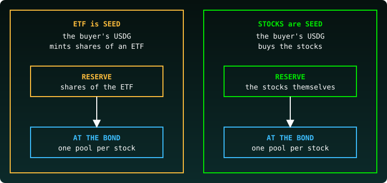
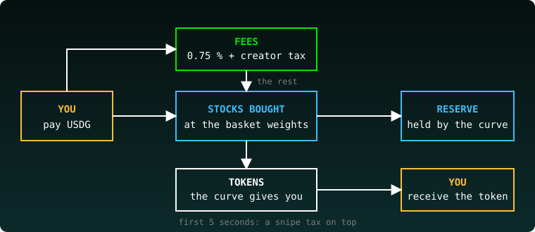
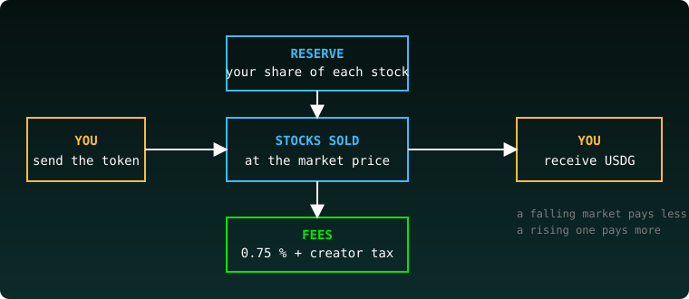
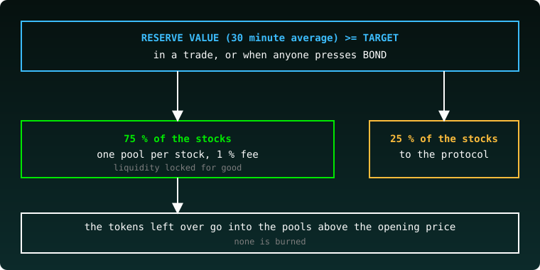

# Launchpad

New tokens, each on its own curve. Pick one, buy in early, and watch it fill toward its bond.

A token can be launched in one of two modes, picked at the top of the launch page:

- **ETF is SEED**: the token is backed by an ETF made with it.
- **STOCKS are SEED**: the token is backed by the stocks themselves.

Both modes end the same way: at the bond, the reserve becomes one pool per stock.

## The list

Each card shows the token's name, its symbol, its price in USDG and a bar: how full the curve is, in %. A curve that reached its target says **bonded**.

Click a card to open the curve. **LAUNCH A TOKEN** (top of the page) starts a new one.

Open it: [square.ilk.finance/launchpad](https://square.ilk.finance/launchpad)

## A curve

- **The bar** at the top: BOND, how far the curve is from its target. At 100 % it reads BONDED.
- **The chart**: the token against USDG, with its market cap. Switch the axis between **$** and **%**.
- **Buy / Sell**: type an amount, set the **slippage**, press the button. Without a wallet it reads CONNECT. On a bonded token, a **Pool** menu (Auto, or one pool) picks where the swap goes.
- **Trades**: every buy and sell, with time, amount in USDG and in tokens.
- **Holders**: who holds the token.
- **Claim**: appears only for someone who has fees to claim.

A curve in ETF is SEED mode also shows an **ETF card**: the stocks behind the token, its NAV / share and its TVL. A curve in STOCKS are SEED mode shows a **stocks table** instead: each stock, its weight, how much the curve holds and what that is worth in USDG.

# Mode 1: ETF is SEED

The token is backed by an ETF created with it. Every buy puts USDG into that ETF's shares, and the curve holds the shares.

### Bonded

When a curve reaches the target the creator picked, it is **bonded**: 30 % of what it holds goes to the protocol, 70 % opens a Uniswap pool, and every token the pool does not take is burned. The token's ETF becomes one pool per stock. The page then shows one pool per stock under the name (SPCX pool, TSLA pool, ...).

### Tutorial: launch a token

Open **LAUNCH A TOKEN** and keep **ETF is SEED** picked. The page is numbered 1 to 7.

1. **Your token.** Fill the **Name** (up to 60 characters) and the **Symbol** (up to 8). Pick the **Supply**: 1 million, 10 million, 100 million, 500 million or 1 billion tokens. Set the **Creator tax during the bonding curve** (0 to 10 %). Pick the **Bond target**, from "Mini bond, 100 shares" to "30,000 shares".
2. **Logo** (optional). **UPLOAD LOGO**: PNG, JPG or SVG, square, 10 KiB max. Without one, the site draws a badge.
3. **Compose the ETF.** Each leg is a stock your ETF holds, like AAPL at 40 %. Pick a stock, set its percent, press **ADD A LEG**. Up to 10 legs, adding up to 100 %.
4. **Keeping the ETF in shape.** The **Rebalance band** (0.10 % to 50.00 %, default 2.00 %): a leg is traded when it drifts more than this from its target. The **Rebalance min interval** (0 to 1,440 min, default 1,200 min): the least time between two rebalances.
5. **Social links** (optional). A description (up to 280 characters), X, Telegram, a website, Discord.
6. **Snipe** (optional). Friends who skip the snipe tax. One address per line, 10 at most.
7. **Ready?** Read the three lines: every trade pays 0.75 %, 70 % to you and 30 % to the protocol; for its first 3 seconds the curve taxes snipers; what happens at the bond. Enter **Your first buy** (USDG), at least 10 USDG. Press **CONNECT**, then launch.

Launching costs 0.001 ETH, plus your first buy, which mints the first shares of your ETF.

Open it: [square.ilk.finance/launchpad/create](https://square.ilk.finance/launchpad/create)

### Tutorial: buy, sell, claim

1. Open a curve from the list.
2. Press **CONNECT** and connect your wallet.
3. **Buy**: type the amount in USDG, check the **slippage**, press the button.
4. **Sell**: open the **Sell** tab, type the amount, press the button.
5. **Claim**: if you have fees to claim, a **Claim** tab shows up next to Trades and Holders. Press **CLAIM**.

Open it: [square.ilk.finance/launchpad](https://square.ilk.finance/launchpad)

# Mode 2: STOCKS are SEED

The token is backed by the stocks themselves. The creator picks a basket of 2 to 10 stock tokens, for example three stocks at 40 / 30 / 30 %. There is no ETF in between.

## What changes for the buyer

- **The reserve holds the stocks.** A buy turns your USDG into the basket's stocks, at the basket's weights, and the curve holds them. You get tokens at the curve's price.
- **A sale sells stocks.** The curve sells your share of its stocks at the market price and pays you the USDG they fetch. A falling market pays less, a rising one pays more.
- **The token's price on the curve follows the tokens sold**, not the stocks. The stocks decide when the curve bonds.

## The bond

The bar on a curve page reads **Bond**, a percent and a figure such as `4,870 / 5,000 USDG`. That figure is what the curve's stocks are worth, taken as their average price over the last 30 minutes. It moves with the market, even when nobody trades.

The curve bonds when that value reaches the target:

- in a trade, a buy or even a sale, that finds the target reached; or
- when anyone presses **BOND**, a button that shows on the curve's page once the target is reached. It pays no reward: whoever holds the token wants it bonded.

Say it plainly: the market can bond a curve. If the stocks rise while a curve is close to its target, the next trade, or a click on BOND, can bond it. If they fall, the curve waits.

At the bond:

- 75 % of the stocks open **one pool per stock**, each paired with the token. The pools are locked: nobody can take their liquidity out.
- 25 % of the stocks go to the protocol.
- The tokens left over are not burned. They are placed in each pool above the opening price.

The card under the bar says what share the protocol takes. After the bond, the pools' trading fees are split 70 % to the creator and 30 % to the protocol, and anyone can press **COLLECT POOL FEES**.

## Fees

- Every trade pays **0.75 %**: 70 % to the creator, 30 % to the protocol.
- The creator's own **tax**, 0 to 10 %, picked at the launch.
- The **snipe tax**, for the first **5 seconds** of a curve: it starts very high and falls to nothing. Friends the creator lists (10 at most), and the creator, skip it. While it lasts, the buy panel warns you: a buy that rushes in on the first second may get almost nothing.

## Tutorial: launch a token

Open **LAUNCH A TOKEN** and pick **STOCKS are SEED**. The page is numbered 1 to 6.

1. **Your token.** Fill the **Name** (up to 64 characters) and the **Symbol** (up to 11). Pick the **Supply**: 1 million, 10 million, 100 million, 500 million or 1 billion tokens. Set the **Creator tax during the bonding curve** (0 to 10 %). Pick the **Bond target**: 5,000, 8,000, 15,000, 20,000, 25,000 or 30,000 USDG. The curve bonds when its stocks are worth this at their 30 minute average price.
2. **Logo** (optional). PNG, JPG or SVG, square, 16 KiB max.
3. **Pick the stocks.** Choose a stock, set its percent, press **ADD A STOCK**. 2 to 10 stocks, adding up to 100 %.
4. **Social links** (optional). A description (up to 280 characters), X, Telegram, a website, Discord.
5. **Snipe** (optional). Friends who skip the snipe tax. One address per line, 10 at most.
6. **Ready?** Read the three lines: every trade pays 0.75 %, 70 % to you and 30 % to the protocol; for its first 5 seconds the curve taxes snipers; at the bond, 75 % of the stocks open one pool per stock and 25 % goes to the protocol. Enter **Your first buy**, at least 10 USDG.

Press **CONNECT**, then **LAUNCH IT**. Launching costs 0.0005 ETH, plus your first buy, which buys the first stocks.

The first buy has a **slippage floor**. The page tries the launch first, sees how many tokens your first buy gives, and signs the least it may give: that amount less your slippage (0.5 % unless you changed it on a curve page; from 0.01 % to 50 %). If the first buy would give less, the launch does not go through. If the simulation shows nothing, nothing is sent.

Open it: [square.ilk.finance/launchpad/create](https://square.ilk.finance/launchpad/create)

## Tutorial: buy, sell, claim

1. Open a curve from the list.
2. Press **CONNECT** and connect your wallet.
3. **Buy**: type the amount in USDG. The page shows the tokens you should get, from a simulation of your trade. Check the **slippage**: it sets the least the trade may give. Press **BUY**, or **APPROVE + BUY** the first time.
4. **Sell**: open the **Sell** tab, type the amount of tokens, or press **25%**, **50%**, **75%** or **MAX**. The page shows the USDG you should get. Press **SELL**, or **APPROVE + SELL** the first time.
5. **Bond**: when the bar says the target is reached, a **BOND** button shows. Anyone can press it.
6. **Claim**: if you have fees to claim, a **Claim** tab shows up next to Trades and Holders. Press the **CLAIM** button.
7. After the bond, the **Pool** menu picks where a swap goes: Auto, or one stock's pool.

Open it: [square.ilk.finance/launchpad](https://square.ilk.finance/launchpad)

## 1-click

On a curve's page, with your wallet connected, the header shows a **1-click** switch.

- **Turn it on**: you approve once. Then every buy and sell is a single signature, with no approval each time.
- **Turn it off**: the approval is revoked.

The contracts, their reviews and the risks are on the [Safety](safety.md) page.

*Experimental software. 100% onchain. Tokens 100% trustless. Not registered funds, not investment advice. Unaudited.*
